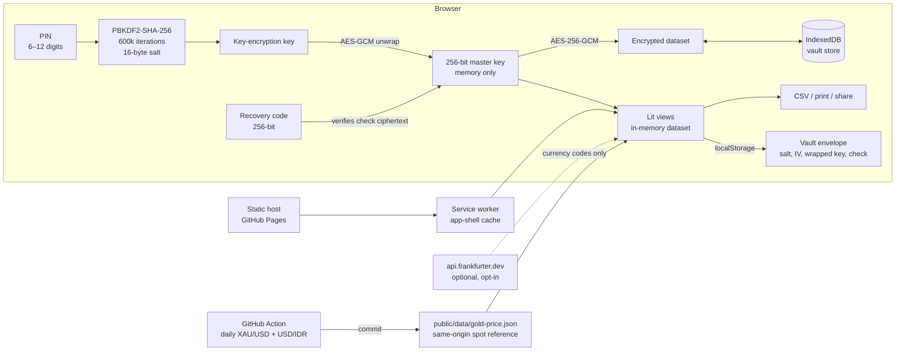
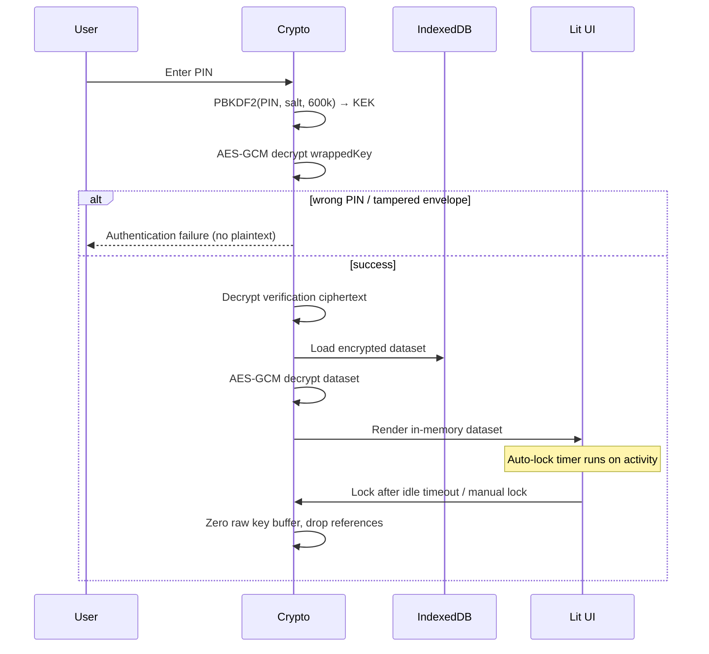

# Architecture

## System overview

The shipped application is a static PWA. There is no application server in the
data path.



## Trust boundaries

1. **Network → browser.** Only static app-shell assets. The single optional
   external origin (`https://api.frankfurter.dev`) receives ISO currency codes,
   never amounts, names, accounts, or identifiers.
2. **Browser storage.** `localStorage` contains only the vault envelope.
   IndexedDB contains one AES-GCM ciphertext blob. There is no plaintext finance
   data at rest.
3. **Unlocked memory.** The master key and decrypted dataset exist in memory only
   while unlocked. Locking zeroes the raw key buffer and drops references. This
   does not protect against malware or extensions already running in the page.
4. **Static host.** GitHub Pages is trusted for integrity of the code it serves.
   A compromised host or account could serve malicious code; CSP cannot prevent a
   same-origin supply-chain compromise. Protect the GitHub account with MFA and
   review deploy history.

## Unlock and lock lifecycle



## Data model

All amounts and rates are stored as decimal strings, not floats. UUIDs are
generated with `crypto.randomUUID()` where available.

```text
Dataset (schemaVersion 2)
├── accounts[]      id, name, type, currency, balance, createdAt
├── transactions[]  id, accountId, type, category, amount, currency, date, createdAt
├── investments[]   id, name, category, principal, cashback, rate, tenor, lots, currency,
│                   units?, nab?, nib?, stockCurrentPrice?, goldGrams?,
│                   goldBuyPricePerGram?, goldCurrentPricePerGram?
├── rates[]         currency, rateToIdr, source (manual|frankfurter), updatedAt
├── settings        autoLockMinutes, ratesAutoSync
└── updatedAt
```

The repository encrypts the entire dataset on every write. At personal-finance
scale this is simpler and safer than per-record encryption and still keeps all
plaintext out of IndexedDB.

## PWA and offline behavior

- `vite-plugin-pwa` generates a Workbox service worker that precaches the app
  shell (HTML, JS, CSS, icons, manifest).
- Navigation falls back to the cached `index.html`.
- API responses are not cached because there is no API.
- `public/data/gold-price.json` is intentionally excluded from precache and uses
  a NetworkFirst runtime cache, so the daily reference refreshes without waiting
  for a new service worker; localStorage is the fallback.
- Updates are prompt-based: a new service worker waits until the user chooses
  "Muat ulang"; `skipWaiting` is not enabled automatically.
- The app is fully functional offline after the first successful load. The UI
  shows an offline banner and all reads/writes stay local.

## Valuation model

Net worth = liquid cash (bank/cash/e-wallet) + current investment value, all in
IDR where a rate exists. Missing rates are surfaced, never converted at 1.0.

| Category | Cost basis | Current value |
|---|---|---|
| Saham | Nilai Investasi − cashback | lot × 100 × current price/share when provided; otherwise cost |
| Reksa Dana | Nilai Investasi − cashback | NIB when provided; otherwise units × NAB; otherwise cost |
| Emas | purchase price/gram × grams − cashback | grams × manual current price/gram, else grams × spot reference, else cost |
| Deposito / Obligasi / P2P / Crypto / Lainnya | Nilai Investasi − cashback | cost basis (category-specific fields kept as metadata) |

The dashboard shows the net-worth hero, liquid/cash, portfolio current value,
cost basis, estimated monthly return, unrealized gain, allocation (stacked bar,
folded to six validated color slots) and a six-month cashflow bar chart. Charts
are inline SVG with text labels in HTML, native hover titles, a legend, and a
table fallback.

## Gold pipeline

`.github/workflows/gold-price.yml` runs daily and on demand. It fetches XAU/USD
spot from gold-api.com and USD/IDR from Frankfurter, converts to IDR per troy
gram, validates plausible ranges, writes `public/data/gold-price.json`, and
commits it. The commit goes through the normal CI gate before Pages deploys.
ANTAM's retail page rejects automated requests (403), so the feed is explicitly
labeled spot and each gold asset supports a manual current price override.

## Key decisions

| Decision | Rationale |
|---|---|
| Remove the FastAPI backend from the runtime | A personal finance PWA with local data has no need for a remote API; this eliminates the original no-auth endpoint surface. |
| Lit instead of Alpine + CDN | No `unsafe-eval`, default escaping, no third-party runtime scripts, strict CSP possible. |
| PBKDF2 rather than a custom scheme | WebCrypto-native, well-understood, adequate with 600k iterations. Argon2id via WASM was considered but adds a supply-chain/bundle cost. |
| Random data key wrapped by PIN-derived key | PIN change re-wraps one key; bulk data is not re-encrypted. |
| Recovery code | Prevents permanent loss without a server-side reset backdoor; the user chooses the recovery-code storage risk. |
| Decimal strings | Avoids floating-point money errors; conversion logic stays exact until display. |
| Missing FX rate = warning, not 1.0 | Silent 1.0 conversion produces plausible but wrong totals. |
| Encrypted backups with a separate passphrase | A backup can be stored off-device without exposing the PIN or recovery code. |
| CSV formula neutralization | Imported names can be attacker-controlled; spreadsheets execute formulas. |
| Category-aware forms | Saham needs lots/price, Reksa Dana needs NIB/NAB/units, Emas needs grams/prices, and tenor only applies to Deposito/Obligasi. |
| Spot gold reference + manual override | ANTAM blocks automated requests; a spot reference is honest and a per-asset override covers retail pricing. |
| Same-origin gold JSON | Keeps the client CSP `connect-src 'self'`; the scheduled workflow, not the browser, talks to external gold/FX APIs. |
| Web Locks around mutations | Prevents two tabs from overwriting each other with stale whole-dataset snapshots. |
| Copy the master key before PIN-change await | A racing lock or auto-lock zeroes the session buffer; wrapping a zeroed key would lose the data key. |

## Repository map

| Path | Responsibility |
|---|---|
| `src/crypto/vault.ts` | PBKDF2, AES-GCM envelope, recovery, backups, throttling |
| `src/db/store.ts` | IndexedDB wrapper; stores ciphertext only |
| `src/db/repository.ts` | Validated mutations, balance updates, persistence |
| `src/domain/` | Types, money, validation, summary, CSV, FX rates |
| `src/ui/` | Lit views: boot/setup/lock, dashboard, modals, icons |
| `src/app.ts` | State, actions, focus management, auto-lock, cross-tab events |
| `.github/workflows/` | CI, CodeQL, GitHub Pages deploy |
| `legacy/api/` | Archived, non-runnable prototype — never deployed |

## Deployment

GitHub Actions builds with `BASE_PATH=/<repo>/`, uploads `dist/`, and deploys to
the `github-pages` environment. Pages serves static files over HTTPS. Because
Pages cannot set custom headers, the build injects a CSP `<meta>` policy and a
frame-buster; header-only controls are documented as residual risks in
`SECURITY.md`.
